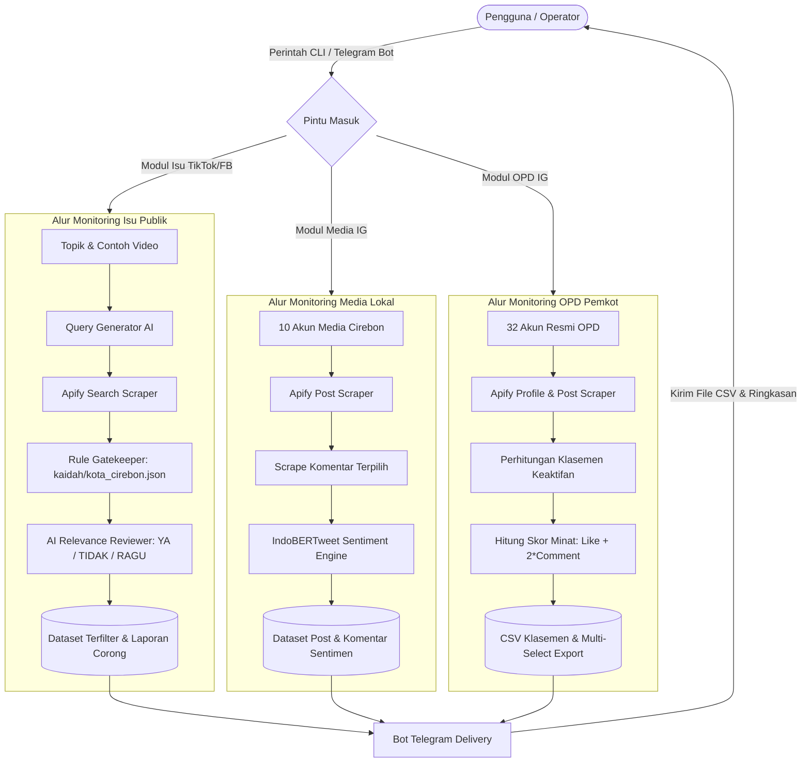

# DKIS Social Media & Public Issue Monitoring System
### Sistem Intelijen Opini Publik & Pemantauan Media Sosial Terpadu (Kota Cirebon)

[](https://www.python.org/)
[]()
[]()
[]()
[]()

---

## 📌 Ringkasan Eksekutif

**DKIS Monitoring System** adalah platform intelijen media sosial yang dirancang khusus untuk **Dinas Komunikasi, Informatika, dan Statistik (DKIS) Pemerintah Kota Cirebon**. Sistem ini mengotomatisasi pemantauan aspirasi masyarakat, deteksi dini isu/keluhan publik di lapangan (seperti banjir, jalan rusak, fasilitas publik, demonstrasi, hingga kebijakan daerah), serta evaluasi kinerja komunikasi publik seluruh Perangkat Daerah (OPD).

### Filosofi Utama: *Separation of Rules, Data & AI Reasoning*
1. **Filter Gerbang Cepat (*Rule Gate*)**: Memangkas spam, konten komersial/judi, dan konten luar wilayah menggunakan aturan wilayah sederhana (`kaidah/kota_cirebon.json`).
2. **Penalaran Kontekstual AI (*Few-Shot Learning*)**: Penilaian relevansi konten diserahkan ke LLM yang belajar dari 3–5 contoh video nyata yang relevan. Tidak ada hardcoding kamus kata kunci yang kaku.
3. **Analisis Sentimen Bahasa Indonesia**: Mengklasifikasi opini netizen pada komentar media massa menggunakan model NLP *IndoBERTweet*.
4. **Antarmuka Ramah ASN (*Zero CLI Telegram Bot*)**: Operator dan pimpinan dapat menjalankan scraping, melihat klasemen keaktifan dinas, serta mengunduh dataset CSV langsung dari aplikasi Telegram tanpa perlu menyentuh terminal/kode.

---

## 🌟 Fitur & Modul Utama

```
                      ┌─────────────────────────────────────────┐
                      │     DKIS Social Media Monitoring        │
                      └────────────────────┬────────────────────┘
                                           │
         ┌──────────────────┬──────────────┴───────┬──────────────────┐
         ▼                  ▼                      ▼                  ▼
  [ 1. TikTok Issue ] [ 2. IG Media ]        [ 3. IG OPD ]      [ 4. Telegram Bot ]
  - 5-Stage Funnel     - 10 Media Lokal       - 32 Akun Pemkot   - Operator Interface
  - Few-Shot AI Gate   - Post & Komentar      - Klasemen Aktif   - Multi-select CSV
  - Laporan Corong     - IndoBERT Sentimen    - Skor Engagement  - Notifikasi Realtime
```

### 1. TikTok Issue Hunter (`tiktok/`)
- **Pencarian Isu Publik Lintas Waktu**: Melacak video berdasarkan topik apa pun (misal: `"banjir"`, `"jalan rusak"`, `"becak listrik"`).
- **Alur Corong 5 Tahap (*5-Stage Funnel*)**:
  1. *Input*: Topik + 1–5 contoh video relevan + rentang tanggal.
  2. *Validasi Caption*: Menolak caption sampah/hashtag-only.
  3. *AI Query Expansion*: LLM menyusun 3–5 variasi kata kunci pencarian yang mengandung entitas lokal Cirebon.
  4. *Scrape & Filter Gerbang*: Pemilahan awal berdasarkan kata wilayah dan filter kata terlarang.
  5. *Gate AI*: LLM mengevaluasi tiap kandidat (**YA / TIDAK / RAGU**) + identifikasi wilayah + alasan transparan.
- **Transparansi & Audit**: Seluruh data mentah (*raw data*), kandidat, konten ditolak, dan laporan rasio corong (`laporan_funnel_*.txt`) tersimpan rapi untuk analisis audit tanpa biaya scraping ulang.

### 2. Instagram Media Monitoring & Sentiment Analysis (`instagram/cirebon_media/`)
- **10 Media Informasi Lokal**: Memantau portal berita dan akun informasi terbesar di Cirebon (*Radar Cirebon, Cirebon Bribin, About Cirebon, dll.*).
- **Ekstraksi Postingan & Komentar**: Penarikan otomatis dengan mekanisme pembatasan adaptif (*smart dynamic rate limiter*) untuk menghindari pemborosan kuota.
- **Klasifikasi Sentimen NLP**: Integrasi model transformer `IndoBERTweet` untuk melabeli komentar publik menjadi **Positif**, **Netral**, atau **Negatif**.

### 3. Instagram OPD Activity & Community Engagement Ranking (`instagram/cirebon_opd/`)
- **Monitoring 32 Akun Resmi Pemkot Cirebon**: Mencakup seluruh Dinas, Badan, Satpol PP, Sekretariat Daerah, hingga 5 Kantor Kecamatan.
- **Klasemen Keaktifan (*Activity Leaderboard*)**: Menghitung total postingan, interaksi, dan konsistensi publikasi setiap instansi dalam rentang hari tertentu.
- **Formula Skor Minat Masyarakat**:
  $$\text{Skor Minat} = \text{Likes} + (2 \times \text{Comments})$$
  Postingan diurutkan dari skor tertinggi untuk menemukan program kerja dinas yang paling diperhatikan masyarakat.
- **Multi-Select Exporter**: Memungkinkan operator memilih dinas tertentu (misal: DKIS + Disbudpar) dan langsung menerima berkas CSV postingannya.

### 4. Facebook Public Issue Monitoring (`facebook/`)
- Arsitektur modular yang kompatibel dengan modul TikTok untuk pemantauan postingan grup/publik di Facebook per topik isu.

### 5. Telegram Bot Assistant (`bot/`)
- **Dirancang Khusus untuk ASN/Staf**: Seluruh alur operasi berjalan via tombol keyboard interaktif Telegram.
- **Eksekusi Aman Sebagai Subproses**: Modul scraper dipanggil sebagai proses terpisah (isolasi memori & toleransi kegagalan).
- **Otorisasi Ketat**: Pembatasan akses berbasis Telegram User ID (`BOT_ALLOWED_USER_IDS` & `BOT_ADMIN_USER_IDS`).

---

## 📐 Arsitektur Alur Data (Data Flow Pipeline)



---

## 📂 Struktur Direktori Proyek

```text
DKIS_MONITORING_FACEBOOK_TIKTOK/
├── main.py                     # Launcher CLI terpadu (TikTok / Facebook)
├── requirements.txt            # Dependensi Python utama
├── .env.example                # Template variabel lingkungan scraper & LLM
├── .gitignore                  # Proteksi file rahasia, log, & cache data
├── DESAIN.md                   # Dokumen teknis desain & riwayat arsitektur
├── STATUS.md                   # Status pengujian & catatan progres lengkap
│
├── kaidah/                     # Knowledge Base Wilayah (Murni Data JSON)
│   └── kota_cirebon.json       # Kata gerbang, tanda lokal dialek, kata terlarang
│
├── topik/                      # Knowledge Base Topik Isu
│   ├── banjir_cirebon/         # Contoh video & varian query pencarian
│   └── banjir_kota_cirebon/    # Contoh positif & contoh negatif hasil filter AI
│
├── tiktok/                     # Modul Pemantauan Isu TikTok
│   ├── code/                   # Modul: config, evaluator, rule_builder, llm_reviewer,
│   │                           # apify_client, storage, main
│   ├── post/                   # Output postingan terfilter & laporan corong
│   ├── comment/                # Output komentar
│   └── history/                # Riwayat audit run ID Apify
│
├── instagram/                  # Modul Pemantauan Instagram
│   ├── cirebon_media/          # Pemantauan 10 akun media berita lokal
│   │   ├── code/               # Scraper media + IndoBERTweet sentiment analyzer
│   │   ├── post/               # Dataset post media
│   │   ├── comment/            # Dataset komentar berlabel sentimen
│   │   └── history/            # Riwayat eksekusi
│   │
│   └── cirebon_opd/            # Pemantauan 32 akun resmi instansi Pemkot Cirebon
│       ├── code/               # Scraper OPD + evaluator skor minat masyarakat
│       ├── data/               # CSV peringkat keaktifan & folder post per OPD
│       └── history/            # Log audit pemantauan OPD
│
├── facebook/                   # Modul Pemantauan Isu Facebook (Struktur identik TikTok)
│   ├── code/                   # Scraper Facebook & evaluasi relevansi
│   └── history/                # Riwayat audit run Facebook
│
└── bot/                        # Pusat Layanan Bot Telegram
    ├── main_bot.py             # Entrypoint bot (Long-polling async worker)
    ├── menu_bot.py             # Antarmuka keyboard Telegram & percakapan interaktif
    ├── job_runner.py           # Eksekutor job scraper di latar belakang (background process)
    ├── bot_config.py           # Konfigurasi bot, otorisasi ID, & tarif estimasi
    ├── telegram_api.py         # Klien komunikasi HTTP bot Telegram murni
    ├── jalankan_bot.bat        # Skrip sekali klik untuk Windows
    ├── .env.example            # Template token & konfigurasi bot Telegram
    ├── data/                   # Sesi aktif bot (.gitkeep)
    └── log/                    # File log eksekusi bot (.gitkeep)
```

---

## 🚀 Panduan Instalasi & Prasyarat

### 1. Prasyarat Sistem
- **Python**: Versi `3.10` atau lebih tinggi (diuji pada Python 3.10–3.12).
- **Sistem Operasi**: Windows 10/11 atau Linux / WSL.
- **Akun Layanan**:
  - [Apify](https://apify.com/): Digunakan sebagai penyedia runner web scraper.
  - Gateway LLM OpenAI-compatible (misal: LLM-Kita, OpenAI, atau gateway internal) untuk penilaian Few-Shot relevansi.
  - Akun Telegram (untuk menjalankan bot melalui [@BotFather](https://t.me/Botfather)).

### 2. Kloning Repositori
```bash
git clone https://github.com/USERNAME/REPO_NAME.git
cd REPO_NAME
```

### 3. Pasang Dependensi Python
```bash
# Dependensi utama (Scraper TikTok, Facebook, Instagram OPD, & Bot Telegram)
pip install -r requirements.txt
```

> [!NOTE]
> Jika Anda ingin menjalankan analisis sentimen lokal *IndoBERTweet* pada modul media Instagram, pasang juga `torch` dan `transformers`:
> ```bash
> pip install torch transformers
> ```

---

## ⚙️ Konfigurasi Variabel Lingkungan (`.env`)

### 1. Konfigurasi Utama (Root `.env`)
Salin berkas `.env.example` di folder utama menjadi `.env`:
```bash
cp .env.example .env
```
Buka file `.env` dan isi kunci API Anda:
```ini
# Token Apify untuk scraper TikTok, Instagram, dan Facebook
APIFY_TOKEN=apify_api_xxxxxxxxxxxxxxxxxxxxxxxxxxxxxxxx

# Gateway LLM untuk AI Gate Relevansi
LLMKITA_API_KEYS=sk-xxxxxxxxxxxxxxxxxxxxxxxxxxxxxxxx
LLMKITA_BASE_URL=https://api.llm-kita.com/api/v1
LLMKITA_MODEL=gpt-5.6-terra
```

### 2. Konfigurasi Bot Telegram (`bot/.env`)
Salin berkas `bot/.env.example` menjadi `bot/.env`:
```bash
cp bot/.env.example bot/.env
```
Isi konfigurasi bot Telegram:
```ini
# Token Bot Telegram dari @BotFather
BOT_TELEGRAM_TOKEN=1234567890:ABCdefGHIjklMNOpqrSTUvwxYZ_contoh

# Telegram User ID yang diberi izin mengakses bot (pisahkan koma)
# Cari tahu ID Anda via @userinfobot di Telegram
BOT_ALLOWED_USER_IDS=8294389351
BOT_ADMIN_USER_IDS=8294389351

# Eksekutor Python yang digunakan bot untuk memanggil scraper
# Windows: python atau C:\Python312\python.exe
# WSL: /mnt/c/Python312/python.exe
BOT_PYTHON_SCRAPER=python
```

---

## 💻 Panduan Penggunaan

### A. Melalui CLI Interaktif (Terminal)

Jalankan launcher utama:
```bash
python main.py
```
Anda akan disuguhkan menu interaktif:
```text
==============================================================================
   MASTER SCRAPPER MONITORING ISU KOTA CIREBON (DKIS)
==============================================================================

PILIH PLATFORM:
  1. TIKTOK    — cari video per topik + gerbang wilayah + penilaian AI
  2. FACEBOOK  — cari post per topik
  3. DUA-DUANYA (TikTok lalu Facebook)
  0. Keluar
```

### B. Mode CLI Langsung (Automasi / Cron / Penjadwalan)

```bash
# Pantau isu banjir di TikTok selama 30 hari terakhir
python main.py --tiktok --topik "banjir" --day 30

# Pantau isu jalan rusak dengan rentang tanggal spesifik
python main.py --tiktok --topik "jalan rusak" --from 2026-08-01 --to 2026-09-30

# Dry Run (hanya membuat varian kata kunci pencarian & estimasi tanpa scrape)
python main.py --tiktok --topik "becak listrik" --day 14 --dry-run

# Mode cepat tanpa evaluasi AI (hanya mengandalkan filter kaidah kata wilayah)
python main.py --tiktok --topik "tanggul jebol" --day 7 --no-llm
```

### C. Menjalankan Bot Telegram (Untuk Operator ASN)

Di lingkungan Windows:
```cmd
cd bot
jalankan_bot.bat
```
Atau melalui terminal langsung:
```bash
python bot/main_bot.py
```

Setelah bot aktif:
1. Buka bot di aplikasi Telegram dan kirim perintah `/start`.
2. Pilih menu yang diinginkan:
   - **Pemantauan Media Lokal Cirebon**: Pilih akun media massa dan rentang hari monitoring.
   - **Pemantauan Akun OPD**: Mulai perayapan 32 akun Pemkot Cirebon.
3. Setelah selesai:
   - Bot otomatis mengirimkan berkas CSV klasemen keaktifan OPD.
   - Bot menampilkan tombol interaktif multi-pilihan untuk mengunduh dataset postingan instan instansi yang diinginkan.

---

## 📊 Standar Format Data (Output Schemas)

### 1. Dataset Postingan OPD (`ranking_keaktifan_opd_*.csv`)
| Kolom | Tipe | Penjelasan |
|---|---|---|
| `scrape_id` | String | Identifier unik sesi scraping |
| `post_id` | String | ID postingan Instagram |
| `post_url` | String | Tautan langsung postingan |
| `created_at` | DateTime | Waktu publikasi postingan |
| `platform` | String | Nama platform (`instagram`) |
| `post_type` | String | Tipe konten (`Image`, `Video`, `Sidecar`) |
| `username` | String | Nama akun dinas / instansi |
| `caption` | String | Isi teks postingan |
| `like_count` | Integer | Jumlah tanda suka |
| `comment_count` | Integer | Jumlah komentar |
| `skor` | Integer | Skor minat masyarakat: $\text{likes} + (2 \times \text{comments})$ |

### 2. Dataset Komentar Media Teranalisis Sentimen
| Kolom | Tipe | Penjelasan |
|---|---|---|
| `comment_id` | String | ID komentar |
| `username` | String | Akun pemberi komentar |
| `text` | String | Teks komentar netizen |
| `timestamp` | DateTime | Waktu komentar dibuat |
| `sentiment_label` | String | Label hasil NLP: `POSITIVE`, `NEUTRAL`, `NEGATIVE` |
| `sentiment_score` | Float | Skor probabilitas keyakinan model (0.00 – 1.00) |

---

## 🛡️ Etika Scraping, Keamanan & Privasi

1. **Nol Rahasia di Kode Sumber (*Zero Secrets in Git*)**: Seluruh token Apify, kunci LLM, dan token Bot Telegram diproteksi melalui `.gitignore` dan hanya dibaca via environment variables.
2. **Kepatuhan Rate Limit & Anggaran**:
   - Sistem dilengkapi pengaturan plafon maksimum komentar dan batasan halaman postingan.
   - File data mentah (`mentah/`) diarsipkan secara lokal sehingga evaluasi AI atau pengujian ulang dapat dijalankan **100% gratis** tanpa memanggil ulang scraper Apify.
3. **Privasi & Kebijakan Data**: Data media sosial yang diambil murni merupakan konten publik yang dapat diakses masyarakat untuk kebutuhan riset analitik kebijakan publik dan evaluasi pelayanan umum Pemerintah Daerah Kota Cirebon.

---

## 👥 Kontributor & Lisensi

- **Institusi**: Dinas Komunikasi, Informatika, dan Statistik (DKIS) Pemerintah Kota Cirebon.
- **Pengembang**: Antares / Tim Pengembang Monitoring DKIS Cirebon.
- **Lisensi**: Proyek ini dilindungi di bawah lisensi internal kedinasan / MIT License.
